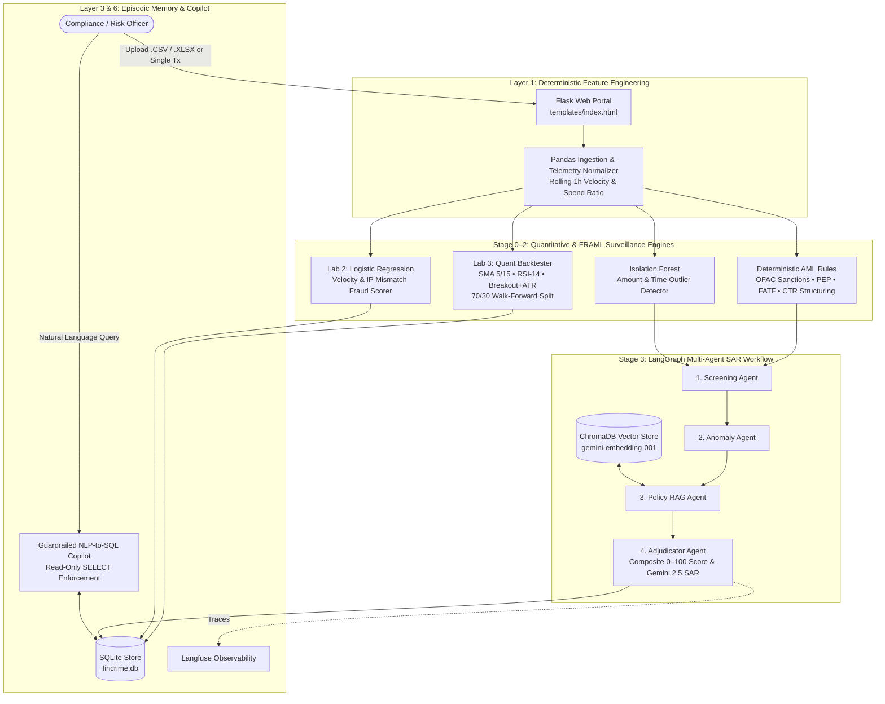

# Unified Quant, FRAML & FinCrime Multi-Agent Surveillance Platform

An institutional-grade **Agentic AI & Quantitative Risk Surveillance** platform that unifies **Algorithmic Strategy Walk-Forward Backtesting**, **FRAML (Fraud + Anti-Money Laundering) Detection**, **ChromaDB Policy RAG**, **LangGraph Multi-Agent SAR Adjudication**, and a **Guardrailed NLP-to-SQL Copilot** into a single full-stack Flask application.

---

## System Architecture

The platform follows a **Deterministic-First, LLM-Grounded** design pattern: all financial calculations, statistical anomaly detection, risk scoring, and SQL guardrails execute in deterministic Python (`pandas`, `scikit-learn`, `SQLite`), while **Gemini 2.5 Flash** is strictly constrained to policy-grounded Suspicious Activity Report (SAR) synthesis and read-only SQL translation.



---

## Core Capabilities

* **Unified Multi-Asset & Compliance Ingestion**: Processes a single `.csv` or `.xlsx` trade/account ledger across all three engines simultaneously—or gracefully falls back to synthetic telemetry when given market-only OHLCV data.
* **Lab 3 Walk-Forward Quant Backtester**: Evaluates candidate strategies (**SMA Crossover 5/15**, **RSI Mean-Reversion 14**, and **Breakout + ATR Stop**) on a **70% In-Sample / 30% Out-of-Sample** split, ranking candidates by annualized Sharpe ratio and cumulative return.
* **Hybrid FRAML Surveillance**: Combines deterministic **OFAC/EU Sanctions**, **PEP**, **FATF High-Risk Jurisdiction**, and **\$9,000–\$9,999 CTR Structuring** rules with unsupervised **Isolation Forest** outlier detection and a calibrated **Logistic Regression** fraud velocity classifier.
* **4-Node LangGraph Multi-Agent Pipeline**: Orchestrates `Screening -> Anomaly -> Policy RAG -> Adjudicator` with `MemorySaver` thread checkpointing and **Langfuse** callback tracing to generate regulatory-grade SAR narratives.
* **Parameterized NLP-to-SQL Copilot**: Translates natural language compliance and quant questions into read-only SQLite `SELECT` queries with strict DDL/DML keyword blocking (`DROP`, `DELETE`, `UPDATE`, `INSERT`, `ALTER`).

---

## Project Structure

```text
├── app.py                              # Flask API, LangGraph agents, ML scorers, Chroma RAG & SQLite layer
├── templates/
│   └── index.html                      # Interactive surveillance dashboard & NLP-to-SQL copilot UI
├── unified_trading_framl_dataset.xlsx  # 240-row multi-symbol test dataset with injected FRAML scenarios
├── requirements.txt                    # Python dependencies
├── .env.example                        # Environment variable template
└── .gitignore                          # Excludes local SQLite DB, Chroma vectors, and secrets
```

---

## Quickstart Setup

### 1. Clone & Install Dependencies
```bash
git clone https://github.com<your-username>/<your-repo-name>.git
cd <your-repo-name>
python -m venv venv
source venv/bin/activate  # On Windows: venv\Scripts\activate
pip install -r requirements.txt
```

### 2. Configure Environment Variables
Create a `.env` file in the root directory:
```env
GEMINI_API_KEY=your_google_gemini_api_key_here
# Optional: Langfuse Tracing
LANGFUSE_PUBLIC_KEY=
LANGFUSE_SECRET_KEY=
```

### 3. Run the Application
```bash
python app.py
```
Open **`http://127.0.0`** in your browser, upload `unified_trading_framl_dataset.xlsx` (or click **Download Sample CSV**), and click **Process Unified File**.
